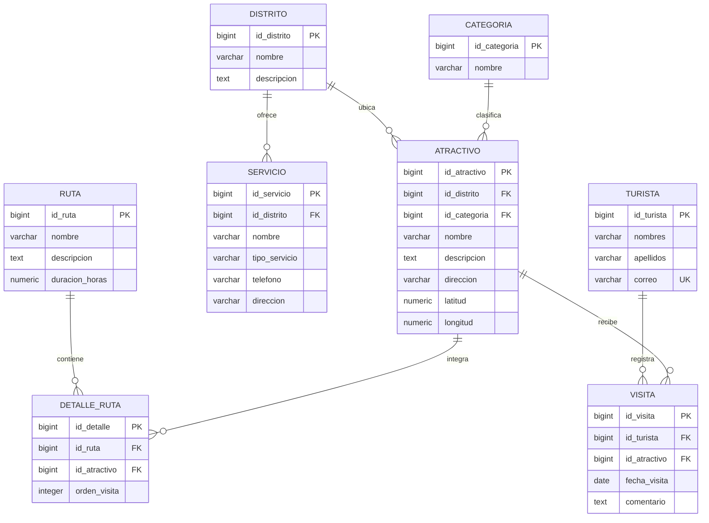

# Diagrama relacional final

Restricciones importantes: `turista.correo` es único; `detalle_ruta` debe tener valores únicos para `(id_ruta, id_atractivo)` y `(id_ruta, orden_visita)`; y `orden_visita` debe ser mayor que cero.
